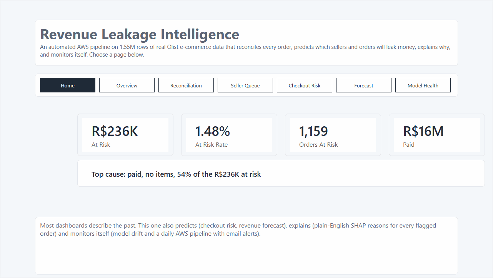
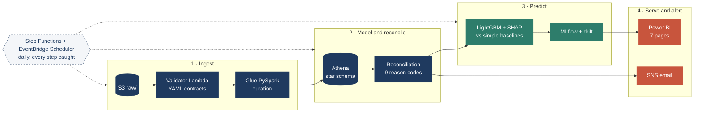
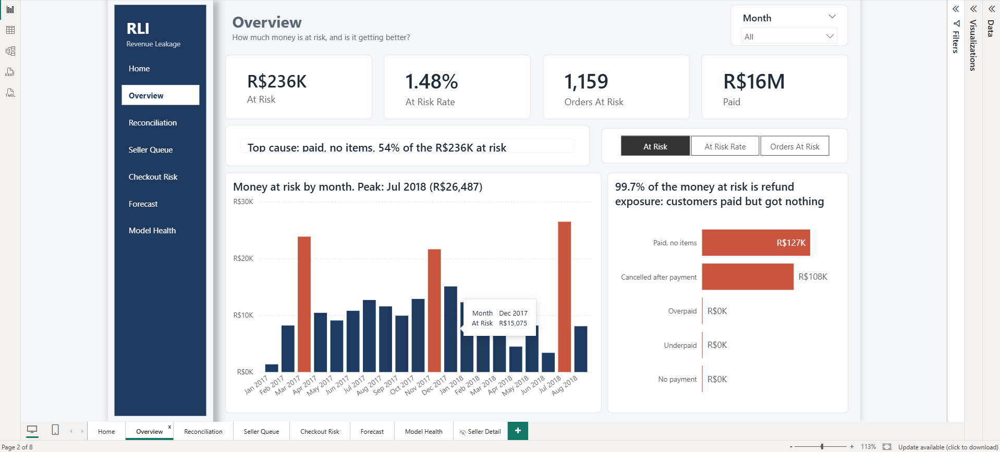
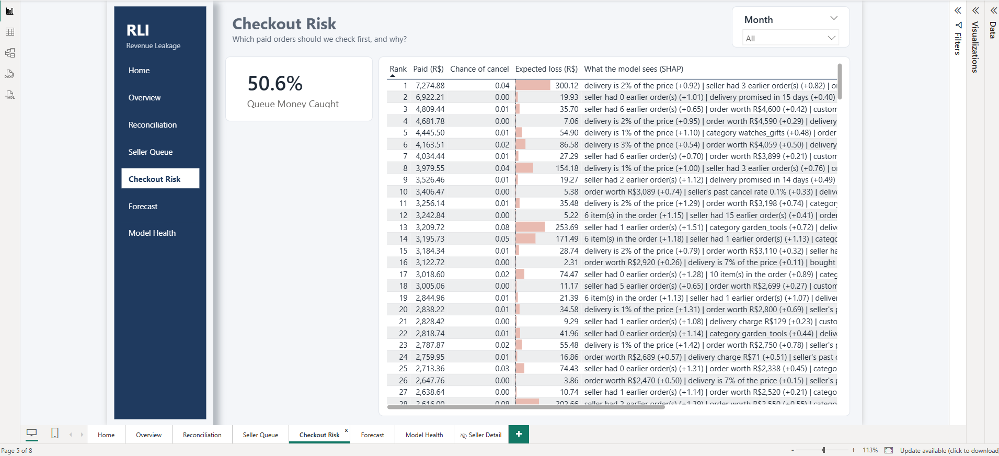

# Revenue Leakage Intelligence

Their dashboards describe the past. Ours also predicts, explains and monitors itself.

## The Problem

An online marketplace takes payment the moment a customer checks out, but the order can still be cancelled, lose its items or be paid twice. In the Olist data, 1,159 orders hold R$236K that customers paid without a clean match to what they received, and 467 of them were cancelled after payment while the amounts still matched to the cent. A reconciliation that only compares totals calls those orders fine, so the refund liability sits unnoticed and the customer leaves a 1-star review. Finance can only review about 1% of orders (around 70 a week), so it needs a system that checks every order every day, says where the money went, and points at the few orders worth checking first.



| Headline | Result |
|---|---|
| Money at risk found | R$236,266 across 1,159 orders, tied out to the cent |
| Rows checked | 1,550,922 across 9 linked tables |
| Review queue | the top 1% of orders held 50.6% of the money later stuck in cancellations (unseen months) |
| Full daily run | 5 min 44 s in AWS, about US$0.10 |
| Tests | 82 unit tests, 43 data and reconciliation checks on every run |

Data: [Olist Brazilian e-commerce](https://www.kaggle.com/datasets/olistbr/brazilian-ecommerce), 99,441 orders from Sep 2016 to Oct 2018, R$16.0M paid. Money stays in Brazilian reais (R$).

## Solution Architecture Diagram



Everything in the diagram is built with **Terraform**, and the same YAML files drive the checks, the Glue types and the Athena tables.

## Walkthrough of the solution

### *1. A file lands and gets checked*

Olist ships 9 tables: orders, items, payments, products, sellers, customers, reviews, geolocation and category names. Each one has a **YAML data contract** listing the required columns, unique keys, allowed dates and legal values. When a file lands in **S3** under `raw/`, an **EventBridge** rule starts the **validator Lambda**.

Each rule is either a **reject** or a **warn**. A rejected row can't be used and goes to `quarantine/` with its reason. A warned row is kept and the rule IDs go into a `dq_flags` column, because rejecting a strange but real payment would hide money from the reconciliation later. The run checked **1,550,922 rows: 0 rejected, 668 flagged**. The 99,441-row orders file took 1.6 seconds.

### *2. Glue cleans and curates*

An **AWS Glue PySpark** job reads only the latest load of each table. Every load is a full snapshot, so reading all of them would double count. The job casts types from the same contracts, fixes misspelled source columns and removes **261,831 duplicate geolocation rows**. The output is Parquet in `curated/`, registered in the **Glue Data Catalog**.

### *3. Athena gives the data a shape*

The curated tables become a **star schema** in **Athena**: 4 dimensions (date, customer, seller, product) and 3 facts (orders, order items, payments). The SQL lives in Git, and `create_models.py` rebuilds everything in dependency order. Olist gives a new `customer_id` to every order, so the facts use `customer_unique_id` instead, which gives 96,096 real customers. Order totals are summed per order before joining to items, so no value repeats once per item.

After every build, **43 checks** run. Structural problems such as duplicates, orphans and join fan-out must be zero. Known gaps, such as 775 orders with no items, are stored with their expected count, so the run fails if the count changes.

### *4. Every order is reconciled*

For each order the pipeline compares what the customer paid with what the items and delivery were worth, then assigns exactly **one of 9 reason codes**. The first matching rule wins. Orders with an unapproved payment are set aside first, then orders with no items, then cancelled orders, and only then is the amount compared within one cent.

The result is **R$236,265.58 at risk across 1,159 orders**, 1.48% of all payments. The two biggest codes are **paid, no items (R$127,417)** and **cancelled after payment (R$108,058)**. The order-level gaps add up to R$165,318.88, the same figure the raw tables give directly, and that **cent-level tie-out** runs as a check every time.

My first headline was R$271K. A hand audit of the 20 largest orders, plus the top 3 of every small code, found 143 orders whose payment was never approved and "instalment fees" of up to 41%. A NOT_APPROVED rule and a 20% instalment cap (95% of real instalment overpayments sat under 15.5%) brought it to **R$236K, the number I would defend in front of finance**. The reasoning is in [docs/reconciliation_findings.md](docs/reconciliation_findings.md) and [docs/reason_codes.md](docs/reason_codes.md).

### *5. The models guess what happens next*

Three questions get a model: which 20 sellers to check each month, which 1% of paid orders to check at checkout, and how much revenue to expect over the next 4 weeks. Features use only what was known at the time, a model is only used if it beats a **simple baseline**, and each method is chosen on one period and confirmed on months it never saw.

| Question | Winner on unseen months | Result |
|---|---|---|
| Which 20 sellers to check? | biggest revenue (simple rule) | 33% of future seller risk came from sellers with no history yet |
| Which 1% of orders to check? | biggest order (simple rule) | 50.6% of the money at risk, likely range about 22% to 65% |
| Revenue for the next 4 weeks? | average of the last 4 weeks | 18.1% error (WAPE), the 80% range held the real value 77.9% of the time |

The checkout model is **LightGBM**, and its **SHAP** reasons sit next to every order in the queue in plain English, for example "seller had 0 earlier orders | delivery promised in 15 days". Every run is logged in **MLflow** with its Git commit, and a **drift check** marks each input and result as OK, WATCH or ALERT. Details are in the [model card](docs/model_card.md).

### *6. The audit that changed a headline*

The first checkout result was 35.6% of the money at risk. The dashboard later showed 1.4% for the same queue, and two causes turned up. LightGBM's bagging picks rows by position and Athena rewrites tables in no fixed order, so the same data trained a different model on every rebuild. Sorting the rows and fixing the LightGBM settings made training **reproducible**, and a test fails if row order ever matters again.

The method had also been picked on one three-month block with only a few cancellations, and across 20 seeds the vote came down to one or two orders. The choice now uses **9 monthly walk-forward windows**, each trained only on orders settled 30 days before that month. A model replaces "biggest order first" only if it wins **2 months in 3 by at least 2 points**. None did. I set that rule after seeing the first holdout result, and the config says so.

### *7. The pipeline runs itself*

**AWS Step Functions** runs the daily chain: curate in Glue, build the models, run the 43 checks, retrain the ML in Glue, then check leakage. An **EventBridge Scheduler** starts it at 6:00 am Sydney time, and it is switched off by default so it costs nothing until a demo. A full run takes **5 min 44 s for about US$0.10**.

Every step has a catch. Broken data stops the run and **SNS** emails "pipeline FAILED" with the error. A bad business number, an at-risk rate above 2% in the latest full month, lets the run finish and emails a leakage alert. All three paths were tested, including a deliberate failure using the word "banana" as the threshold. Drift is reported on every run but doesn't email, because the at-risk rate improving from 0.89% to 0.30% already shows ALERT, and daily emails about good news teach people to ignore alerts.

### *8. Finance opens the dashboard*

**Power BI** imports the marts and ML tables from Athena through the **Athena ODBC** connector. The 7 pages answer one question each:

| Page | Question |
|---|---|
| Home | What is this, and where do I start? |
| Overview | How much money is at risk, and is it getting better? |
| Reconciliation | Where is the money at risk, and why? |
| Seller Queue | Which 20 sellers should finance check this month? |
| Checkout Risk | Which paid orders should we check first, and what does the model see? |
| Forecast | What revenue should we expect over the next 4 weeks? |
| Model Health | Can we still trust the models and the pipeline? |

A **field parameter** switches the Overview KPI between money, rate and order count, spike months show in red, titles update with the selected month, and a right-click on a seller drills through to their orders.




The report, a PDF export and all page screenshots are in [powerbi/](powerbi/).

## How to run it

You need Python 3, Terraform, the AWS CLI and an AWS account.

```
pip install -r requirements.txt
python -m pytest -q                     # 82 tests, no AWS needed
cd terraform; terraform apply; cd ..    # S3, Lambda, Glue, Athena, Step Functions, SNS, Scheduler
python scripts/create_models.py         # build the star schema and marts in Athena
python scripts/check_models.py          # 43 checks
python scripts/run_ml_pipeline.py       # 7 ML steps, publishes the ml_ tables
```

The ML pipeline is one script that runs the same way on a laptop and inside the Glue job. In my sandbox account an organisation policy later blocked starting Glue jobs, so the last runs were local. The code path is identical.

## Repo map

```
config/      data contracts, model checks, ML and alert settings (YAML)
lambda/      validator and models Lambda handlers
glue/        curation and ML job entry points
sql/         star schema, reconciliation and mart models
src/         validation engine, warehouse build and checks, ML code
scripts/     command-line entry points
terraform/   all AWS infrastructure
tests/       82 unit tests
docs/        problem statement, reason codes, findings, model card
powerbi/     report, theme, PDF, screenshots, walkthrough GIF
```

## Limits

Olist has no refunds table, so the R$236K is money at risk, not confirmed unrefunded money. 54% of it sits on orders with no items, so it can't be traced to a seller or product. Cancellations are rare (90 in the four holdout months), so every queue result is quoted with a range.

Built by Kazi Abdul Mubin, Master of Data Science, Macquarie University.
