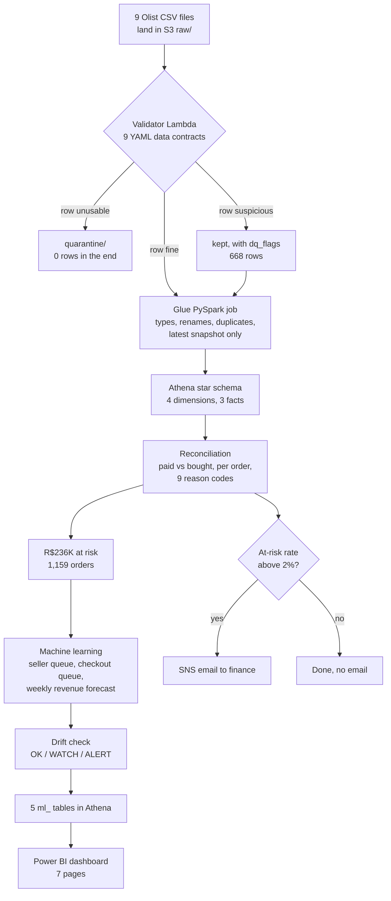
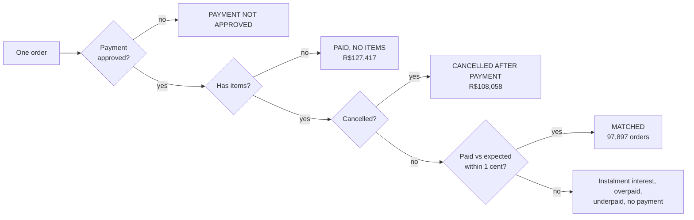
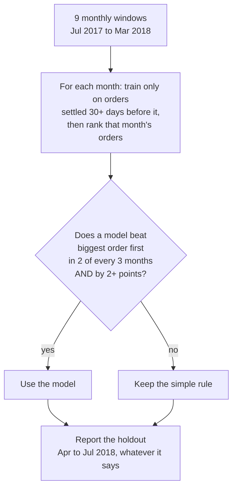
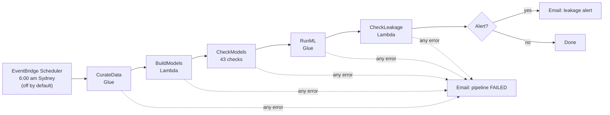

# Revenue Leakage Intelligence

An AWS pipeline that follows every order in a real e-commerce dataset from the moment the file lands to the moment finance sees it on a dashboard. Along the way it checks the data, reconciles what customers paid against what they bought, finds the money at risk, predicts where the next losses will come from, and emails someone when a number crosses a line.

Their dashboards describe the past. Ours also predicts, explains and monitors itself.


| Headline | Result |
|---|---|
| Money at risk found | R$236,266 across 1,159 orders, tied out to the cent |
| Rows checked | 1,550,922 across 9 linked tables |
| Review queue | the top 1% of orders held 50.6% of the money later stuck in cancellations (unseen months) |
| Full daily run | 5 min 44 s in AWS, about US$0.10 |
| Tests | 82 unit tests, 43 data and reconciliation checks on every run |

Data: [Olist Brazilian e-commerce](https://www.kaggle.com/datasets/olistbr/brazilian-ecommerce), 99,441 orders from Sep 2016 to Oct 2018, R$16.0M paid. Money stays in Brazilian reais (R$).

## The story in one picture



The rest of this page walks through that picture one stop at a time.

## Chapter 1: a file arrives

Olist ships 9 tables (orders, items, payments, products, sellers, customers, reviews, geolocation, category names). Each one has a YAML data contract that says which columns must exist, which keys must be unique, which dates are allowed and which values are legal.

When a file lands in `raw/`, EventBridge starts the validator Lambda. Every rule is either a reject (the row can't be used, so it goes to `quarantine/` with a reason) or a warn (the row is kept and the rule IDs are written to a `dq_flags` column). Suspicious rows are kept on purpose. Rejecting a strange but real payment would hide money from the reconciliation later.

Result: 1,550,922 rows checked, 0 rejected, 668 flagged. The Lambda checked the 99,441-row orders file in 1.6 seconds.

A Glue PySpark job then reads only the latest load of each table (every load is a full snapshot, so reading all of them would double count), casts the types from the same contracts, and removes 261,831 exact duplicate geolocation rows. The same YAML files drive the Lambda checks, the Glue types and the Athena table definitions, so a schema change is one edit.

## Chapter 2: the data gets a shape

The curated tables become a star schema in Athena: `dim_date`, `dim_customer`, `dim_seller`, `dim_product`, plus `fact_orders`, `fact_order_items` and `fact_payments`. The SQL lives in Git and one command rebuilds everything.

Olist gives a new `customer_id` to every order, so the facts use `customer_unique_id` instead (96,096 real customers). Order-level totals are summed per order before joining to items, which stops values repeating once per item.

43 checks run after every build. Structural checks (duplicates, orphans, join fan-out) must be zero. Known business gaps, such as 775 orders with no items, are recorded with their expected count, so the run fails if the count changes.

## Chapter 3: following the money

For every order the pipeline compares what the customer paid with what the items and delivery were worth, then gives the order exactly one reason code. The first rule that matches wins.



Total at risk: R$236,265.58 across 1,159 orders, which is 1.48% of all payments. The order-level gaps add up to R$165,318.88, the same figure you get from the raw tables directly, and that tie-out runs as a check every time.

The cancelled-after-payment group is the interesting one. Those 467 orders match to within R$32.01 in total, so a reconciliation that only compares amounts calls them fine. The customer paid R$108,058 and the goods never shipped.

My first headline was R$271K. Before trusting it I audited the 20 largest orders by hand plus the top 3 of every small reason code. Two problems came out. 143 orders were never approved (mostly vouchers), so no money had actually moved, and some "instalment fees" were 41% of the order. A NOT_APPROVED rule and a 20% instalment cap, set from the real distribution (95% of instalment overpayments were under 15.5%), took the number to R$236K. That is the number I would defend in front of finance.

Full findings: [docs/reconciliation_findings.md](docs/reconciliation_findings.md) and [docs/reason_codes.md](docs/reason_codes.md).

## Chapter 4: guessing what happens next

Finding past losses is half the job. Finance also wants to know which sellers and which new orders to check this week. Every model here is held to three rules: features only use information that existed at the time, a simple baseline has to be beaten, and the method is chosen on one period and confirmed on months it never saw.

| Question | Winner on unseen months | What it means |
|---|---|---|
| Which 20 sellers to check each month? | biggest revenue (simple rule) | LightGBM was steadier but never clearly better, and 33% of future seller risk came from sellers with no history yet |
| Which 1% of paid orders to check? | biggest order (simple rule) | 50.6% of the money at risk, likely range about 22% to 65% |
| Revenue for the next 4 weeks? | average of the last 4 weeks | 18.1% error (WAPE); the 80% range held the real value 77.9% of the time |

Losing to a simple rule is a real result, and the pipeline reports it instead of hiding it. The checkout model still earns a place. Its SHAP reasons appear next to every order in the queue in plain English, for example "seller had 0 earlier orders | delivery promised in 15 days".

### The audit that changed a headline

Phase 4 reported that the checkout queue caught 35.6% of the money at risk. When the dashboard came along it showed 1.4% for the same queue. Two causes turned up.

First, LightGBM's bagging picks rows by position, and Athena rewrites the tables in no fixed order. The same data gave a different model on every rebuild. Sorting the training rows and fixing the LightGBM settings made it reproducible, and a test now fails if row order ever matters again.

Second, the method was picked on one three-month tuning block that held only a few cancellations. Across 20 random seeds the vote was decided by one or two orders, and on the unseen months the ranking flipped. The choice now works like this:



No model passed, so the queue reviews the biggest orders. I set this rule after seeing the first holdout result, and the config file says so.

Model details and limits: [docs/model_card.md](docs/model_card.md). Every run is tracked in MLflow with its Git commit.

## Chapter 5: it runs without me



Step Functions runs the chain and every step has a catch that sends a failure email. Broken data stops the run. A bad business number lets the run finish and sends an alert. I tested all three paths: a clean run, a forced alert with a 0.1% test line, and a deliberate failure with a non-numeric line (the word "banana").

Drift is reported on every run but doesn't email by default. It already shows ALERT on history, because the at-risk rate improved from 0.89% to 0.30%, and a daily email about good news would train people to ignore the alerts.

Everything is Terraform with least-privilege IAM per component. The schedule is a Terraform variable that starts off, so the project costs nothing until it is switched on.

## Chapter 6: what finance sees

| Page | Question it answers |
|---|---|
| Home | What is this and where do I start? |
| Overview | How much money is at risk, and is it getting better? |
| Reconciliation | Where is the money at risk, and why? |
| Seller Queue | Which 20 sellers should finance check this month? (right-click to drill through) |
| Checkout Risk | Which paid orders should we check first, and what does the model see? |
| Forecast | What revenue should we expect in the next 4 weeks? |
| Model Health | Can we still trust the models and the pipeline? |


Power BI connects to Athena (Import mode). The report, a PDF export and all page screenshots are in [powerbi/](powerbi/).

## How to run it

You need Python 3, Terraform, the AWS CLI and an AWS account.

```
pip install -r requirements.txt
python -m pytest -q                     # 82 tests, no AWS needed
cd terraform; terraform apply; cd ..    # S3, Lambda, Glue, Athena, Step Functions, SNS, Scheduler
python scripts/create_models.py         # build the star schema and marts in Athena
python scripts/check_models.py          # 43 checks
python scripts/run_ml_pipeline.py       # 7 ML steps, publishes the ml_ tables
```

The ML pipeline is one script that runs the same way on a laptop and inside the Glue job. In my sandbox account an organisation policy later blocked starting Glue jobs, so the last runs were local. The code path is identical.

## Repo map

```
config/      data contracts, model checks, ML and alert settings (YAML)
lambda/      validator and models Lambda handlers
glue/        curation and ML job entry points
sql/         star schema, reconciliation and mart models
src/         validation engine, warehouse build and checks, ML code
scripts/     command-line entry points
terraform/   all AWS infrastructure
tests/       82 unit tests
docs/        problem statement, reason codes, findings, model card
powerbi/     report, theme, PDF, screenshots, walkthrough GIF
```

## Limits

Olist has no refunds table, so the R$236K is money at risk, not confirmed unrefunded money. 54% of it sits on orders with no items, so it can't be traced to a seller or product. Cancellations are rare (90 in the four holdout months), so every queue result is quoted with a range.

Built by Kazi Abdul Mubin, Master of Data Science, Macquarie University.
